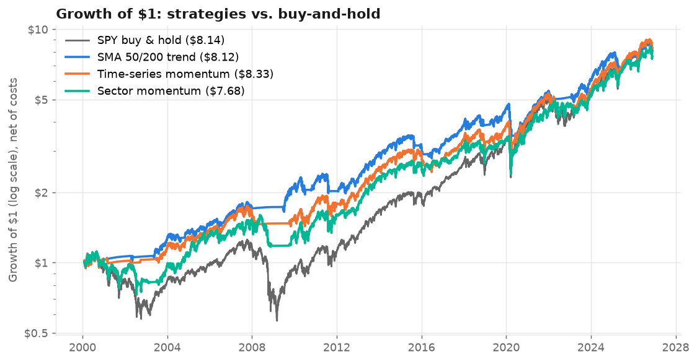
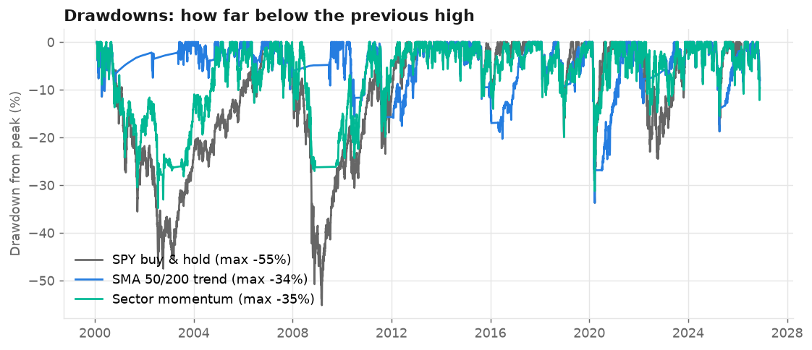
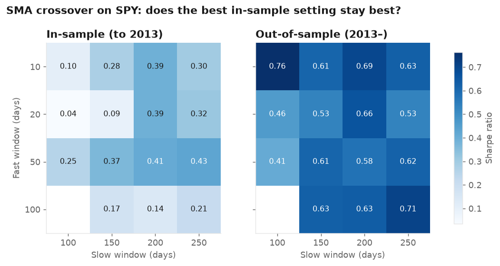

# Algorithmic Trading Strategy

[](https://siiirrreee-algo-trading.streamlit.app/)

A Python research framework that builds **trend-following and momentum strategies**, backtests them on two decades of daily ETF data **after trading costs and slippage**, guards against **look-ahead and survivorship bias**, compares them with buy-and-hold, and then asks the question most backtests skip: **is the result distinguishable from luck?**

> **Question:** Do simple, well-known trading rules (moving-average crossovers, time-series momentum and sector rotation) beat just holding the S&P 500 once you charge realistic costs, trade only on information you had at the time, and correct for having tried many parameter settings?

This is Project 4 of my quant portfolio, after [Project 1: Options Pricing Model](https://github.com/Siiirrreee/options-pricing-model), [Project 2: Monte Carlo Simulation](https://github.com/Siiirrreee/monte-carlo-financial-simulation) and [Project 3: Portfolio Optimization Engine](https://github.com/Siiirrreee/portfolio-optimization-engine).



## What it does

| Step | Detail |
|---|---|
| Data | Daily dividend-adjusted closes for SPY and the 11 Select Sector SPDR ETFs from 1999; 3-month T-bill rate (FRED) as the cash return. Cached in `data/` and refreshed weekly by GitHub Actions |
| Strategies | SMA 50/200 crossover on SPY · 12-1 month time-series momentum on SPY · cross-sectional sector momentum (top 3 of 11, monthly, with an absolute-momentum cash filter) |
| Benchmarks | SPY buy-and-hold, and an equal-weight sector portfolio for the sector strategy |
| Backtester | Daily, weights drift between rebalances, cash earns T-bills, **trades execute one day after the signal**, costs = commission + slippage on every dollar traded |
| Bias controls | Look-ahead: lagged execution plus a test that scrambles future prices and checks the past does not change. Survivorship: a universe fixed in advance with point-in-time eligibility for late-launching funds |
| Metrics | CAGR, volatility, Sharpe, Sortino, max drawdown and its length, Calmar, beta, alpha, turnover, cost drag, time invested |
| Robustness | In-sample/out-of-sample split, SMA and momentum parameter grids, annual walk-forward re-optimisation, cost sensitivity from 0 to 50 bps |
| Statistics | Probabilistic Sharpe ratio, **deflated Sharpe ratio** for multiple testing, stationary block bootstrap of the Sharpe difference vs. SPY |
| Output | CSV tables, `stats.json`, a written summary, six charts, and an interactive Streamlit app |

## Results

<!-- RESULTS:START -->
_Daily adjusted closes from Yahoo Finance (yfinance), 2000-02-02 to 2026-11-25; cash earns the 3-month T-bill rate.
Every trade costs 10 bps of the traded amount (commission + slippage) and executes 1 day after the signal.
In-sample / out-of-sample split at 2013-01-01. Full detail in [results/summary.md](results/summary.md)._

**Performance, 2000–2026, net of costs**

|                      | CAGR   | Volatility   |   Sharpe |   Sortino | Max drawdown   |   Calmar |   Beta | Alpha / yr   | Turnover / yr   | Cost drag / yr   | Time invested   |
|:---------------------|:-------|:-------------|---------:|----------:|:---------------|---------:|-------:|:-------------|:----------------|:-----------------|:----------------|
| SPY buy & hold       | 8.1%   | 19.2%        |     0.4  |      0.57 | -55%           |     0.15 |   1    | 0.0%         | 0.0×            | 0.00%            | 100%            |
| Sector equal weight  | 8.8%   | 18.0%        |     0.45 |      0.63 | -53%           |     0.17 |   0.9  | 1.1%         | 0.3×            | 0.03%            | 100%            |
| SMA 50/200 trend     | 8.1%   | 13.4%        |     0.51 |      0.7  | -34%           |     0.24 |   0.49 | 3.0%         | 1.0×            | 0.10%            | 74%             |
| Time-series momentum | 8.2%   | 14.3%        |     0.49 |      0.69 | -34%           |     0.24 |   0.56 | 2.7%         | 4.2×            | 0.42%            | 78%             |
| Sector momentum      | 7.9%   | 17.2%        |     0.42 |      0.58 | -35%           |     0.23 |   0.7  | 1.8%         | 5.1×            | 0.51%            | 95%             |

**Out of sample only (2013–2026)**

|                      | CAGR   | Volatility   |   Sharpe | Max drawdown   |
|:---------------------|:-------|:-------------|---------:|:---------------|
| SPY buy & hold       | 14.0%  | 16.8%        |     0.76 | -34%           |
| Sector equal weight  | 12.4%  | 15.7%        |     0.71 | -36%           |
| SMA 50/200 trend     | 9.5%   | 14.5%        |     0.58 | -34%           |
| Time-series momentum | 10.8%  | 15.5%        |     0.63 | -34%           |
| Sector momentum      | 11.3%  | 17.1%        |     0.61 | -31%           |

**Is it real? Statistical tests (vs. SPY buy-and-hold)**

|                      |   Sharpe |   t-stat (excess return) | PSR (SR > 0)   |   Trials |   Hurdle Sharpe | Deflated Sharpe   |   Sharpe − SPY | 95% CI         | P(boot ≤ 0)   |
|:---------------------|---------:|-------------------------:|:---------------|---------:|----------------:|:------------------|---------------:|:---------------|:--------------|
| SMA 50/200 trend     |     0.51 |                     2.63 | 100%           |       15 |            0.15 | 97%               |           0.1  | -0.18 to +0.41 | 24%           |
| Time-series momentum |     0.49 |                     2.54 | 99%            |        4 |            0.23 | 91%               |           0.09 | -0.17 to +0.35 | 26%           |
| Sector momentum      |     0.42 |                     2.16 | 98%            |       12 |            0.14 | 93%               |           0.01 | -0.20 to +0.22 | 47%           |

_PSR: probability the true Sharpe is above zero, adjusted for skew and fat tails. Deflated Sharpe: the same probability
against the best Sharpe expected from the number of parameter sets tried. CI and P(boot ≤ 0): stationary block bootstrap
of the paired daily returns, 21-day mean blocks._

**Trading-cost sensitivity**

|   Cost per trade (bps) |   SMA 50/200 trend Sharpe |   Time-series momentum Sharpe |   Sector momentum Sharpe | SMA 50/200 trend CAGR   | Time-series momentum CAGR   | Sector momentum CAGR   |
|-----------------------:|--------------------------:|------------------------------:|-------------------------:|:------------------------|:----------------------------|:-----------------------|
|                      0 |                      0.52 |                          0.51 |                     0.44 | 8.5%                    | 8.6%                        | 8.3%                   |
|                      5 |                      0.52 |                          0.49 |                     0.42 | 8.4%                    | 8.3%                        | 8.0%                   |
|                     10 |                      0.52 |                          0.48 |                     0.41 | 8.4%                    | 8.1%                        | 7.8%                   |
|                     25 |                      0.51 |                          0.44 |                     0.37 | 8.2%                    | 7.5%                        | 7.0%                   |
|                     50 |                      0.49 |                          0.36 |                     0.29 | 7.9%                    | 6.4%                        | 5.7%                   |

**SMA parameter grid: in-sample vs. out-of-sample Sharpe (sorted by in-sample rank)**

|   fast |   slow |   IS Sharpe |   OOS Sharpe |   IS rank |   OOS rank |
|-------:|-------:|------------:|-------------:|----------:|-----------:|
|     50 |    250 |        0.43 |         0.62 |         1 |          8 |
|     50 |    200 |        0.41 |         0.58 |         2 |         11 |
|     20 |    200 |        0.39 |         0.66 |         3 |          4 |
|     10 |    200 |        0.39 |         0.69 |         4 |          3 |
|     50 |    150 |        0.37 |         0.61 |         5 |         10 |
|     20 |    250 |        0.32 |         0.53 |         6 |         12 |
|     10 |    250 |        0.3  |         0.63 |         7 |          6 |
|     10 |    150 |        0.28 |         0.61 |         8 |          9 |
|     50 |    100 |        0.25 |         0.41 |         9 |         15 |
|    100 |    250 |        0.21 |         0.71 |        10 |          2 |
|    100 |    150 |        0.17 |         0.63 |        11 |          7 |
|    100 |    200 |        0.14 |         0.63 |        12 |          5 |
|     10 |    100 |        0.1  |         0.76 |        13 |          1 |
|     20 |    150 |        0.09 |         0.53 |        14 |         13 |
|     20 |    100 |        0.04 |         0.46 |        15 |         14 |

**Walk-forward SMA (2004–2026, re-optimised each January on the trailing 5 years)**

|                  | CAGR   | Volatility   |   Sharpe | Max drawdown   | Turnover / yr   |
|:-----------------|:-------|:-------------|---------:|:---------------|:----------------|
| SMA walk-forward | 6.7%   | 13.4%        |     0.42 | -34%           | 2.1×            |
| SMA 50/200 trend | 8.5%   | 13.7%        |     0.53 | -34%           | 1.0×            |
| SPY buy & hold   | 10.5%  | 18.6%        |     0.53 | -55%           | –               |

_Chosen windows: 2004: 50/100, 2005: 50/250, 2006: 50/250, 2007: 50/250, 2008: 50/250, 2009: 50/250, 2010: 50/200, 2011: 10/100, 2012: 20/200, 2013: 50/100, 2014: 50/100, 2015: 50/100, 2016: 50/150, 2017: 100/150, 2018: 100/150, 2019: 20/200, 2020: 100/250, 2021: 10/100, 2022: 10/100, 2023: 10/100, 2024: 10/200, 2025: 10/200, 2026: 20/200._

**Key findings**

- Over the full period, SPY buy-and-hold returned **8.1% a year** with a Sharpe of 0.40 and a **-55%** worst drawdown. The best risk-adjusted strategy was **SMA 50/200 trend** (Sharpe 0.51, CAGR 8.1%, max drawdown -34%).
- The trend filters' clearest effect is on **risk**: SMA 50/200 trend and Time-series momentum cut the worst drawdown from -55% to -34% / -34% by moving to T-bills in long declines, while staying invested 74% / 78% of the time. Beta falls to 0.49 / 0.56.
- Only Time-series momentum beat buy-and-hold on raw return (8.2% vs 8.1%).
- **Statistical significance.** No strategy's Sharpe improvement over SPY is significant at 5%: SMA 50/200 trend +0.10 (95% CI -0.18 to +0.41); Time-series momentum +0.09 (95% CI -0.17 to +0.35); Sector momentum +0.01 (95% CI -0.20 to +0.22). With about two decades of daily data, Sharpe differences of this size are hard to tell apart from luck.
- **Multiple-testing correction.** The deflated Sharpe ratio asks whether the result beats the best of all parameter sets tried, not zero: SMA 50/200 trend 97% (vs 100% unadjusted, 15 trials); Time-series momentum 91% (vs 99% unadjusted, 4 trials); Sector momentum 93% (vs 98% unadjusted, 12 trials). A deflated value below 95% means the edge does not survive the search.
- **Overfitting check.** On the 15-setting SMA grid, the best in-sample choice (50/250, Sharpe 0.43) ranked **#8 of 15** after 2013 (Sharpe 0.62). The rank correlation between in-sample and out-of-sample Sharpe is 0.10: in-sample rankings told you little about what would work next.
- **Walk-forward.** Re-optimising the SMA windows every January on the trailing five years earned a Sharpe of 0.42 out of sample, below the fixed textbook 50/200 rule (0.53) over the same years. Optimisation added nothing reliable over a rule fixed in advance.
- **Sector momentum vs. its own benchmark.** Against an equal-weight portfolio of the same sectors (Sharpe 0.45), sector momentum's Sharpe difference is -0.03 (95% CI -0.25 to +0.18). It trades 5.1× its capital a year, costing 0.51% annually at 10 bps.
- **Costs.** Moving from 0 to 50 bps per trade lowers Sharpe by SMA 50/200 trend 0.04; Time-series momentum 0.14; Sector momentum 0.15. Sector momentum is the most cost-sensitive: it trades 5.1× its capital a year.
- **After 2013** (out of sample): SPY Sharpe 0.76, SMA 50/200 trend 0.58, Time-series momentum 0.63, Sector momentum 0.61. Every strategy lagged buy-and-hold on a risk-adjusted basis in the untouched period.
<!-- RESULTS:END -->





| Bootstrap: Sharpe difference vs. SPY | Trading-cost sensitivity |
|---|---|
|  |  |


## How it works

**Signals.** Each strategy outputs a target weight decided at the close of day $t$ using prices up to $t$ only.

- *SMA crossover:* hold SPY when $\text{SMA}_{50}(t) > \text{SMA}_{200}(t)$, otherwise T-bills.
- *Time-series momentum:* hold SPY when its return from 12 months ago to 1 month ago is positive: $P_{t-21}/P_{t-252} - 1 > 0$. Skipping the latest month avoids the short-term reversal effect.
- *Sector momentum:* at each month end rank the sectors by the same 12-1 return, hold the top 3 at 1/3 each, and send a slot to cash if its own momentum is negative (dual momentum).

**Execution and costs.** A target formed at the close of $t$ trades at the close of $t+1$ and first earns the return of $t+2$. Between trades, weights drift with prices. Each trade costs

$$\text{cost}_t = c \sum_i \lvert w_{i,t}^{\text{new}} - w_{i,t}^{\text{drifted}} \rvert, \qquad c = \text{commission} + \text{slippage} = 10\text{ bps by default}$$

and the uninvested share of the portfolio earns the T-bill rate.

**Avoiding look-ahead bias.** Besides the execution lag, `tests/test_backtest.py` multiplies every price after a cut-off date by random noise and checks that every signal and every daily return up to the cut-off is unchanged. A loop-based reference check confirms the engine reproduces hand-computed returns.

**Avoiding survivorship bias.** Picking today's winners and testing them on the past inflates results. The universe here is fixed in advance: the sector SPDRs, none of which has been delisted. XLRE (2015) and XLC (2018) have no prices before launch and become eligible only once they have 12 months of history.

**Is it luck?** A Sharpe ratio estimated from data has a standard error. The **probabilistic Sharpe ratio** (Bailey & López de Prado, 2012) is the probability the true Sharpe is above zero, adjusting for skew and fat tails:

$$\text{PSR} = \Phi\!\left(\frac{(\widehat{SR} - SR^*)\sqrt{n-1}}{\sqrt{1 - \gamma_3 \widehat{SR} + \tfrac{\gamma_4 - 1}{4}\widehat{SR}^2}}\right)$$

The **deflated Sharpe ratio** sets $SR^*$ to the best Sharpe you would expect from $N$ worthless strategies, so trying 15 parameter sets raises the bar. A **stationary block bootstrap** (Politis & Romano, 1994) resamples blocks of paired strategy/SPY days to build a confidence interval for the Sharpe difference while keeping volatility clustering.

**Walk-forward.** Each January the SMA windows with the best Sharpe over the previous five years are chosen and traded for the next 12 months only. The stitched record is a genuinely out-of-sample result.

## Live demo

**[siiirrreee-algo-trading.streamlit.app](https://siiirrreee-algo-trading.streamlit.app/)**: the Streamlit app (`app.py`) lets you change the strategy, its parameters, trading costs, execution lag and period, and immediately see performance, drawdowns, the bootstrap test and annual returns.

To run it locally: `streamlit run app.py`.

## Project structure

```
├── main.py                      # runs the full pipeline (CLI) and updates this README
├── app.py                       # interactive Streamlit backtester
├── src/algo_trading/
│   ├── data.py                  # download, cache and clean prices and T-bill rates
│   ├── strategies.py            # SMA crossover, time-series and cross-sectional momentum
│   ├── backtest.py              # daily engine: execution lag, drifting weights, costs
│   ├── metrics.py               # CAGR, Sharpe, Sortino, drawdowns, alpha/beta
│   ├── stats_tests.py           # PSR, deflated Sharpe, stationary bootstrap
│   ├── walkforward.py           # parameter grids, IS/OOS split, walk-forward, cost sensitivity
│   └── visuals.py               # Matplotlib charts
├── notebooks/                   # step-by-step walkthrough
├── tests/                       # pytest: no look-ahead, lag, costs, drift, launch dates, metrics, statistics
├── data/                        # cached prices and T-bill rates
├── results/                     # CSV tables, stats.json, summary.md
└── visuals/                     # charts used in this README
```

A GitHub Actions workflow runs the tests, downloads fresh data, runs the full pipeline and commits the refreshed results on every push and once a week.

## Run it

```bash
python -m venv .venv
# Windows: .venv\Scripts\activate    macOS/Linux: source .venv/bin/activate
pip install -r requirements.txt
python main.py                   # uses cached data in data/
python main.py --refresh-data    # re-download prices and T-bill rates
python main.py --cost-bps 25     # harsher trading costs
python main.py --lag 2           # trade two days after the signal
python -m pytest                 # run the tests
streamlit run app.py             # interactive app
```

Use the engine directly:

```python
import sys; sys.path.insert(0, "src")
from algo_trading import load_data, sma_crossover, run_backtest, Costs, performance

px, rf, info = load_data()
signal = sma_crossover(px["SPY"], fast=50, slow=200)
res = run_backtest(px, signal, rf, Costs(commission_bps=5, slippage_bps=5), lag=1)
performance(res, rf)            # CAGR, Sharpe, max drawdown, turnover, cost drag...
```

## Limitations

- **A good backtest is not a forecast.** Even with every bias control here, past performance does not establish that a rule will work in the future. Market regimes change and well-known effects get arbitraged away.
- **Closing prices only.** Trades fill at the next day's close. Real execution happens intraday at prices that may be worse, and cost is modelled as a flat rate rather than one that grows with trade size.
- **Few independent bets.** Two strategies trade a single asset, so their histories contain only a few dozen regime switches. That is why the confidence intervals are wide.
- **Taxes ignored.** Frequent switching would realise capital gains that buy-and-hold defers.
- **ETF universe.** Sector ETFs avoid the survivorship problem of individual stocks, but a stock-level momentum study would need point-in-time index membership data.

## Next steps

- Volatility targeting: scale exposure by forecast volatility (feeds into the GARCH model of Project 5)
- Multi-asset trend following across equities, bonds, commodities and currencies
- Event-driven cross-check of the engine in Backtrader
- Combinatorially purged cross-validation for strategy selection
- Factor regressions of strategy returns (feeds into Project 6)

## Tech

Python · pandas · NumPy · SciPy · Matplotlib · yfinance · Streamlit · pytest · GitHub Actions

---
*Educational project, not investment advice. Backtested results are hypothetical and do not reflect actual trading.*
