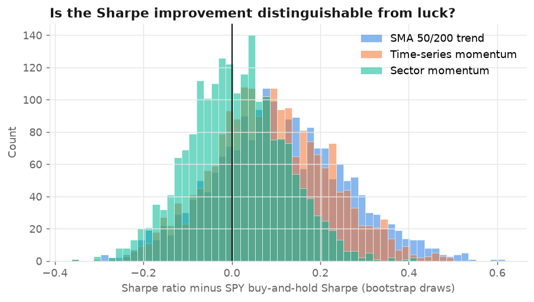
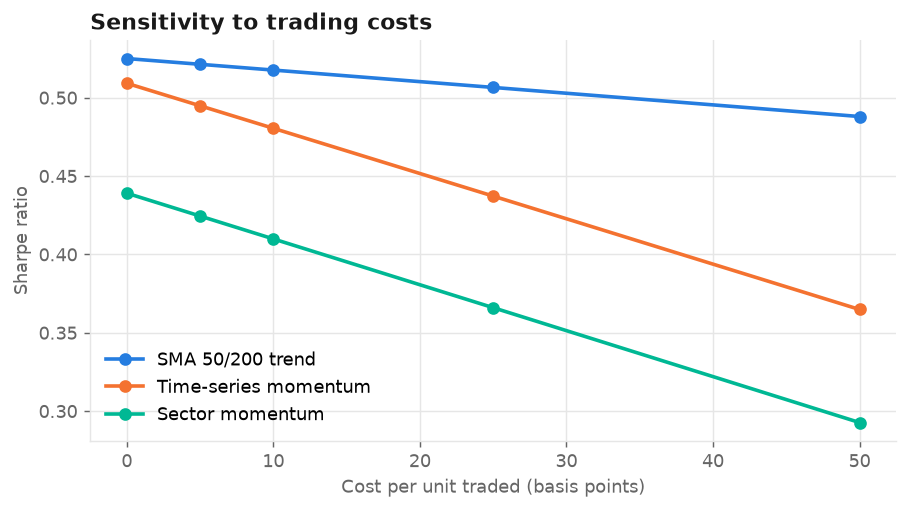
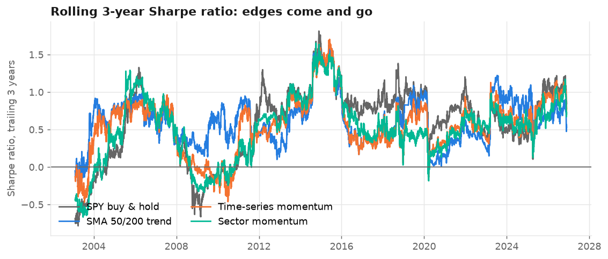

# Algorithmic Trading Strategy

[](https://siiirrreee-algo-trading.streamlit.app/)

A Python research framework that builds **trend-following and momentum strategies**, backtests them on two decades of daily ETF data **after trading costs and slippage**, guards against **look-ahead and survivorship bias**, compares them with buy-and-hold, and then asks the question most backtests skip: **is the result distinguishable from luck?**

> **Question:** Do simple, well-known trading rules (moving-average crossovers, time-series momentum and sector rotation) beat just holding the S&P 500 once you charge realistic costs, trade only on information you had at the time, and correct for having tried many parameter settings?

This is Project 4 of my quant portfolio, after [Project 1: Options Pricing Model](https://github.com/Siiirrreee/options-pricing-model), [Project 2: Monte Carlo Simulation](https://github.com/Siiirrreee/monte-carlo-financial-simulation) and [Project 3: Portfolio Optimization Engine](https://github.com/Siiirrreee/portfolio-optimization-engine).


## What it does

| Step | Detail |
|---|---|
| Data | Daily dividend-adjusted closes for SPY and the 11 Select Sector SPDR ETFs from 1999; 3-month T-bill rate (FRED) as the cash return. Cached in `data/` and refreshed weekly by GitHub Actions |
| Strategies | SMA 50/200 crossover on SPY · 12-1 month time-series momentum on SPY · cross-sectional sector momentum (top 3 of 11, monthly, with an absolute-momentum cash filter) |
| Benchmarks | SPY buy-and-hold, and an equal-weight sector portfolio for the sector strategy |
| Backtester | Daily, weights drift between rebalances, cash earns T-bills, **trades execute one day after the signal**, costs = commission + slippage on every dollar traded |
| Bias controls | Look-ahead: lagged execution plus a test that scrambles future prices and checks the past does not change. Survivorship: a universe fixed in advance with point-in-time eligibility for late-launching funds |
| Metrics | CAGR, volatility, Sharpe, Sortino, max drawdown and its length, Calmar, beta, alpha, turnover, cost drag, time invested |
| Robustness | In-sample/out-of-sample split, SMA and momentum parameter grids, annual walk-forward re-optimisation, cost sensitivity from 0 to 50 bps |
| Statistics | Probabilistic Sharpe ratio, **deflated Sharpe ratio** for multiple testing, stationary block bootstrap of the Sharpe difference vs. SPY |
| Output | CSV tables, `stats.json`, a written summary, six charts, and an interactive Streamlit app |

## Results

<!-- RESULTS:START -->
_Results are generated by `python main.py` and refreshed automatically by GitHub Actions._
<!-- RESULTS:END -->


| Bootstrap: Sharpe difference vs. SPY | Trading-cost sensitivity |
|---|---|
|  |  |



## How it works

**Signals.** Each strategy outputs a target weight decided at the close of day $t$ using prices up to $t$ only.

- *SMA crossover:* hold SPY when $\text{SMA}_{50}(t) > \text{SMA}_{200}(t)$, otherwise T-bills.
- *Time-series momentum:* hold SPY when its return from 12 months ago to 1 month ago is positive: $P_{t-21}/P_{t-252} - 1 > 0$. Skipping the latest month avoids the short-term reversal effect.
- *Sector momentum:* at each month end rank the sectors by the same 12-1 return, hold the top 3 at 1/3 each, and send a slot to cash if its own momentum is negative (dual momentum).

**Execution and costs.** A target formed at the close of $t$ trades at the close of $t+1$ and first earns the return of $t+2$. Between trades, weights drift with prices. Each trade costs

$$\text{cost}_t = c \sum_i \lvert w_{i,t}^{\text{new}} - w_{i,t}^{\text{drifted}} \rvert, \qquad c = \text{commission} + \text{slippage} = 10\text{ bps by default}$$

and the uninvested share of the portfolio earns the T-bill rate.

**Avoiding look-ahead bias.** Besides the execution lag, `tests/test_backtest.py` multiplies every price after a cut-off date by random noise and checks that every signal and every daily return up to the cut-off is unchanged. A loop-based reference check confirms the engine reproduces hand-computed returns.

**Avoiding survivorship bias.** Picking today's winners and testing them on the past inflates results. The universe here is fixed in advance: the sector SPDRs, none of which has been delisted. XLRE (2015) and XLC (2018) have no prices before launch and become eligible only once they have 12 months of history.

**Is it luck?** A Sharpe ratio estimated from data has a standard error. The **probabilistic Sharpe ratio** (Bailey & López de Prado, 2012) is the probability the true Sharpe is above zero, adjusting for skew and fat tails:

$$\text{PSR} = \Phi\!\left(\frac{(\widehat{SR} - SR^*)\sqrt{n-1}}{\sqrt{1 - \gamma_3 \widehat{SR} + \tfrac{\gamma_4 - 1}{4}\widehat{SR}^2}}\right)$$

The **deflated Sharpe ratio** sets $SR^*$ to the best Sharpe you would expect from $N$ worthless strategies, so trying 15 parameter sets raises the bar. A **stationary block bootstrap** (Politis & Romano, 1994) resamples blocks of paired strategy/SPY days to build a confidence interval for the Sharpe difference while keeping volatility clustering.

**Walk-forward.** Each January the SMA windows with the best Sharpe over the previous five years are chosen and traded for the next 12 months only. The stitched record is a genuinely out-of-sample result.

## Live demo

**[siiirrreee-algo-trading.streamlit.app](https://siiirrreee-algo-trading.streamlit.app/)**: the Streamlit app (`app.py`) lets you change the strategy, its parameters, trading costs, execution lag and period, and immediately see performance, drawdowns, the bootstrap test and annual returns.

To run it locally: `streamlit run app.py`.

## Project structure

```
├── main.py                      # runs the full pipeline (CLI) and updates this README
├── app.py                       # interactive Streamlit backtester
├── src/algo_trading/
│   ├── data.py                  # download, cache and clean prices and T-bill rates
│   ├── strategies.py            # SMA crossover, time-series and cross-sectional momentum
│   ├── backtest.py              # daily engine: execution lag, drifting weights, costs
│   ├── metrics.py               # CAGR, Sharpe, Sortino, drawdowns, alpha/beta
│   ├── stats_tests.py           # PSR, deflated Sharpe, stationary bootstrap
│   ├── walkforward.py           # parameter grids, IS/OOS split, walk-forward, cost sensitivity
│   └── visuals.py               # Matplotlib charts
├── notebooks/                   # step-by-step walkthrough
├── tests/                       # pytest: no look-ahead, lag, costs, drift, launch dates, metrics, statistics
├── data/                        # cached prices and T-bill rates
├── results/                     # CSV tables, stats.json, summary.md
└── visuals/                     # charts used in this README
```

A GitHub Actions workflow runs the tests, downloads fresh data, runs the full pipeline and commits the refreshed results on every push and once a week.

## Run it

```bash
python -m venv .venv
# Windows: .venv\Scripts\activate    macOS/Linux: source .venv/bin/activate
pip install -r requirements.txt
python main.py                   # uses cached data in data/
python main.py --refresh-data    # re-download prices and T-bill rates
python main.py --cost-bps 25     # harsher trading costs
python main.py --lag 2           # trade two days after the signal
python -m pytest                 # run the tests
streamlit run app.py             # interactive app
```

Use the engine directly:

```python
import sys; sys.path.insert(0, "src")
from algo_trading import load_data, sma_crossover, run_backtest, Costs, performance

px, rf, info = load_data()
signal = sma_crossover(px["SPY"], fast=50, slow=200)
res = run_backtest(px, signal, rf, Costs(commission_bps=5, slippage_bps=5), lag=1)
performance(res, rf)            # CAGR, Sharpe, max drawdown, turnover, cost drag...
```

## Limitations

- **A good backtest is not a forecast.** Even with every bias control here, past performance does not establish that a rule will work in the future. Market regimes change and well-known effects get arbitraged away.
- **Closing prices only.** Trades fill at the next day's close. Real execution happens intraday at prices that may be worse, and cost is modelled as a flat rate rather than one that grows with trade size.
- **Few independent bets.** Two strategies trade a single asset, so their histories contain only a few dozen regime switches. That is why the confidence intervals are wide.
- **Taxes ignored.** Frequent switching would realise capital gains that buy-and-hold defers.
- **ETF universe.** Sector ETFs avoid the survivorship problem of individual stocks, but a stock-level momentum study would need point-in-time index membership data.

## Next steps

- Volatility targeting: scale exposure by forecast volatility (feeds into the GARCH model of Project 5)
- Multi-asset trend following across equities, bonds, commodities and currencies
- Event-driven cross-check of the engine in Backtrader
- Combinatorially purged cross-validation for strategy selection
- Factor regressions of strategy returns (feeds into Project 6)

## Tech

Python · pandas · NumPy · SciPy · Matplotlib · yfinance · Streamlit · pytest · GitHub Actions

---
*Educational project, not investment advice. Backtested results are hypothetical and do not reflect actual trading.*
